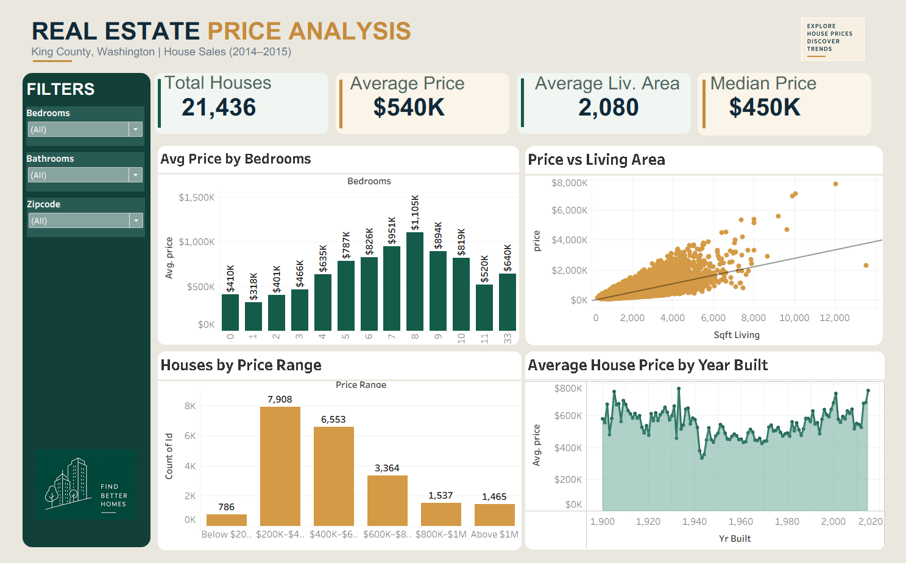

# 🏡 Real Estate Price Analysis Dashboard

<p align="center">
  
</p>

<h3 align="center">Explore House Prices • Discover Trends • Make Better Decisions</h3>

<p align="center">
  An interactive Tableau dashboard analyzing residential property sales in King County, Washington (2014–2015).
</p>

<p align="center">
  
  
  
</p>

---

## 📊 Dashboard Preview

<p align="center">
  
</p>

---

## 📌 Table of Contents

- [Overview](#-overview)
- [Key Performance Indicators](#-key-performance-indicators)
- [Dashboard Features](#-dashboard-features)
- [Visualizations](#-visualizations)
- [Key Insights](#-key-insights)
- [Dataset Information](#-dataset-information)
- [Tools & Technologies](#-tools--technologies)
- [Project Structure](#-project-structure)
- [How to Run](#-how-to-run)
- [What I Learned](#-what-i-learned)
- [Connect With Me](#-connect-with-me)

---

## 🎯 Overview

The **Real Estate Price Analysis Dashboard** is an interactive data visualization project built using Tableau.

The project explores residential property sales data from King County, Washington, to understand housing prices, property characteristics, and market trends.

The dashboard allows users to interact with the data using filters and explore relationships between property features and their selling prices.

**Main objective:** Transform raw housing data into meaningful visual insights that support better understanding of the real estate market.

---

## 📈 Key Performance Indicators

| KPI | Value |
|---|---:|
| Total Sales Records | 21,436 distinct property IDs |
| Average House Price | $540.1K |
| Median House Price | $450K |
| Average Living Area | 2,080 sq ft |

---

## ✨ Dashboard Features

- **Interactive Filters:** Explore properties by bedrooms, bathrooms, and zipcode.
- **KPI Cards:** Get a quick overview of important housing metrics.
- **Price Comparison:** Compare average house prices across bedroom categories.
- **Price Distribution:** Understand how houses are distributed across price ranges.
- **Relationship Analysis:** Explore the relationship between living area and house prices.
- **Historical Trends:** Analyze average house prices based on construction year.

---

## 📊 Visualizations

| Visualization | Purpose |
|---|---|
| Average Price by Bedrooms | Compare average prices across bedroom counts |
| Price vs. Living Area | Understand the relationship between house size and price |
| Houses by Price Range | Explore the distribution of properties across price categories |
| Average Price by Year Built | Analyze price patterns by construction year |

---

## 🔍 Key Insights

- The average house price is approximately **$540.1K**.
- The median house price is approximately **$450K**.
- The average living area is approximately **2,080 sq ft**.
- Living area and house price show a positive relationship in the scatter plot.
- Average house prices vary across bedroom categories and construction years.

---

## 🗂️ Dataset Information

**Dataset:** King County House Sales Dataset

The dataset contains residential property sales information, including:

- Property price
- Bedrooms and bathrooms
- Living area and lot size
- Year built and renovated
- Location and zipcode
- Property condition and grade

The analysis covers house sales from **May 2014 to May 2015**.

---

## 🛠️ Tools & Technologies

<p>
  
  
  
  
  
</p>

- **Tableau Public:** Dashboard creation and interactive visualization.
- **Python:** Data exploration and analysis.
- **Pandas:** Data manipulation and preprocessing.
- **Git & GitHub:** Version control and project hosting.

---

## 📁 Project Structure

```text
Real-Estate-Price-Analysis/
│
├── assets/
│   ├── dashboard.png
│   └── find_better_homes.png
│
├── data/
│   └── kc_house_data.csv
│
├── Real_Estate_Price_Analysis.twbx
├── README.md
└── .gitignore
```

---

## 🚀 How to Run

1. Clone this repository:

   ```bash
   git clone https://github.com/YOUR_USERNAME/Real-Estate-Price-Analysis.git
   ```

2. Open the downloaded project folder.

3. Install or open **Tableau Public**.

4. Open `Real_Estate_Price_Analysis.twbx`.

5. Explore the dashboard using its interactive filters and visualizations.

---

## 🎓 What I Learned

Through this project, I gained practical experience in:

- Data exploration and understanding datasets.
- Building interactive dashboards in Tableau.
- Designing KPI cards and data visualizations.
- Creating calculated fields and filters.
- Identifying patterns and relationships in real estate data.
- Presenting analytical findings through visual storytelling.

---

## 🤝 Connect With Me

**Kunal Walunj**  
Aspiring Data Scientist | Machine Learning • Python • FastAPI

---

<p align="center">
  ⭐ If you find this project interesting, consider giving it a star!
</p>

<p align="center">
  <b>Built with curiosity, data, and Tableau.</b>
</p>